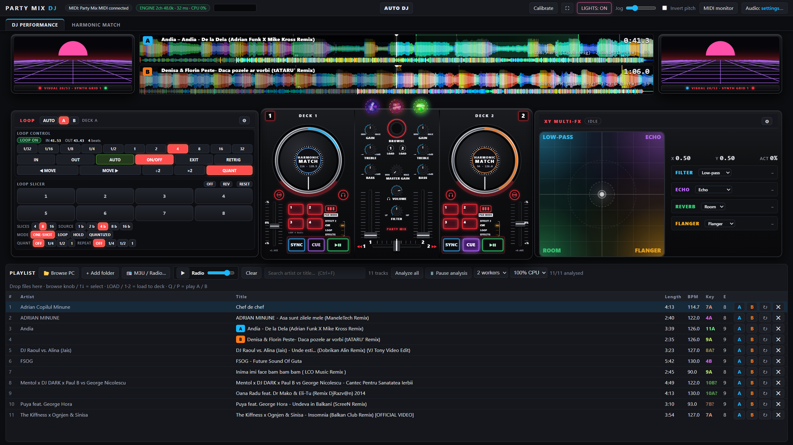
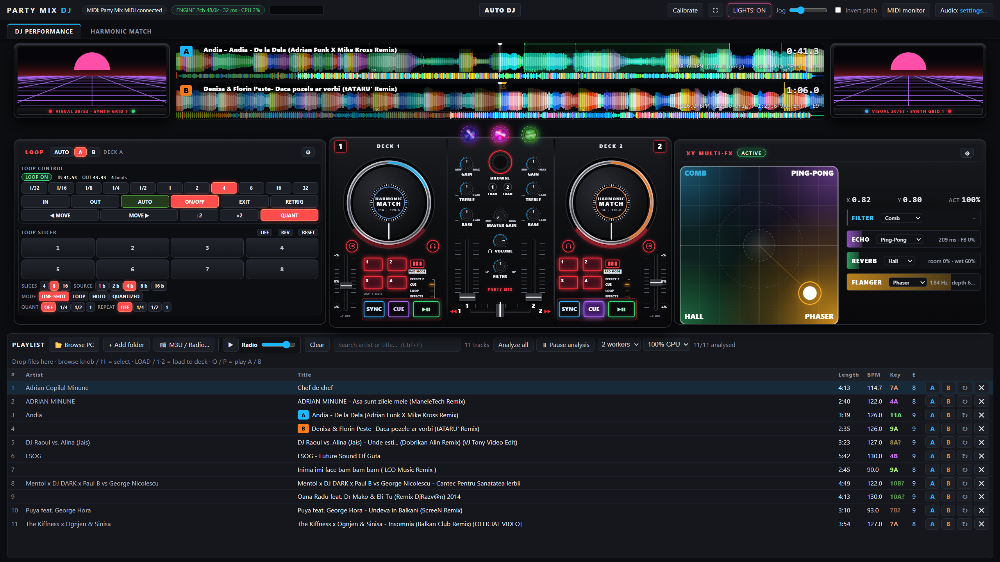
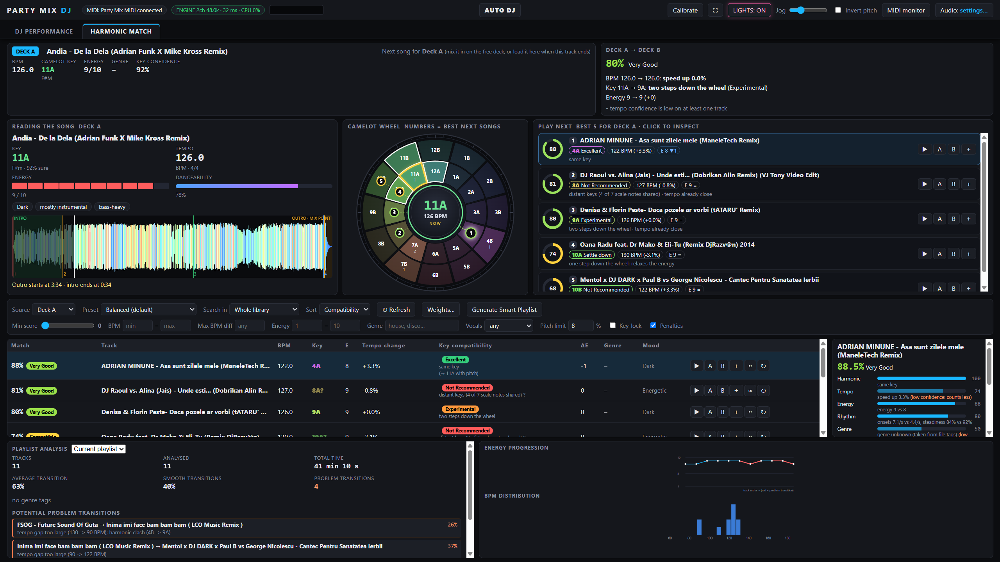
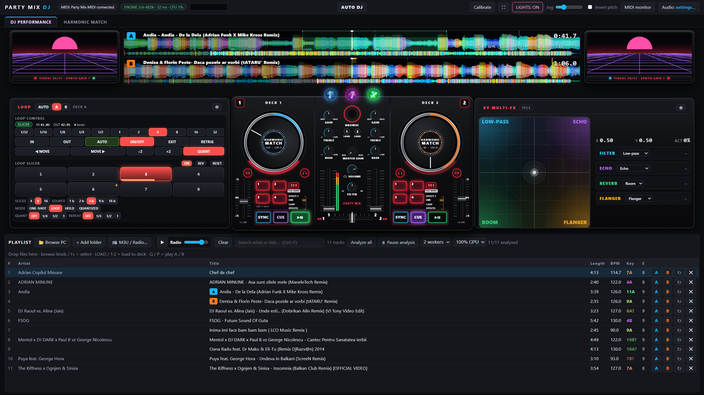
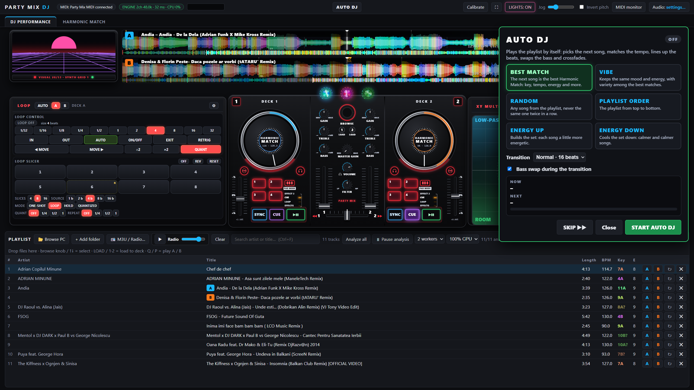

# Party Mix DJ — free DJ software for the Numark Party Mix

**Party Mix DJ is free, dedicated DJ software built for the Numark Party Mix controller.** Plug in your Party Mix and you get a complete two-deck DJ setup: scrolling colour waveforms, a native low-latency audio engine, harmonic mixing with a Camelot wheel, beat-grid loops and a loop slicer, 36 pad effects, an XY multi-FX pad with 28 effects, Auto DJ, and every knob, fader, pad, jog wheel and LED of the controller mapped and working. No subscription, no licence key.

[**⬇ Download the latest installer**](https://github.com/unupunct/Party-Mix-DJ/releases/latest) · Windows 10 / 11 · 64-bit · installs per user, no admin rights needed

## Why Party Mix DJ
The Numark Party Mix is a great little party controller, but it ships with a basic, stripped-down companion app. Party Mix DJ replaces it with proper DJ software designed around exactly this hardware, so nothing on the controller is wasted: the jog wheels scratch and search, the PAD MODE button switches between CUE, LOOP, EFFECTS and EFFECT 2 on each deck, the headphone jack carries a real cue mix, and the three party lights on top follow the beat.

## Best features

### Two decks that feel like a pro setup
- **Colour waveforms you can control with the mouse**: click to play / pause, drag to rewind or forward, mouse wheel to zoom (shift + wheel nudges the position). Intro and outro zones, bar numbers and phrase marks on the beat grid, a time ruler, cue points, loop regions and a glowing playhead.
- **Beat-grid sync, pitch fader, hot cues, vinyl-style brake** when you pause, and **automatic cue points** after analysis: first beat, end of the intro, the chorus or drop, and the start of the outro, snapped to the bar grid.
- **Native Rust audio engine** (WASAPI) with the master mix on channels 1/2 and the **headphone cue on channels 3/4** of the Party Mix, per-deck EQ, a master filter, a limiter and a Web Audio fallback.

### Loop Control and Loop Slicer
- **Loops from 1/32 to 32 beats**, beat-grid quantised: loop in, loop out, auto loop, on/off, exit, re-trigger, move by one loop length, double or halve.
- **Loop Slicer** with 4, 8 or 16 pads on the loop: **one-shot, loop, hold and quantised** modes, per-slice **reverse**, a rhythmic **repeat**, trigger quantisation to 1/4, 1/2 or 1 beat. It runs inside the audio engine, so slice jumps are **sample-accurate and click-free**, and a slice always rejoins the groove exactly where the loop would have been.

### XY Multi-FX pad (28 effects)
- **Press and move** on one square to blend **Filter, Echo, Reverb and Flanger**; the centre is neutral and dry, and **releasing returns to the clean signal at once** (a 4 ms click-free fade, no tails).
- **Seven effects per family, chosen on every row**: filter (low-pass, high-pass, band-pass, notch, comb, vowel, peak boost), echo (echo, ping-pong, tape, dub, slapback, reverse, triplet), reverb (room, hall, plate, spring, gated, swell, dark) and flanger (flanger, phaser, chorus, vibrato, tremolo, auto-pan, ring mod).
- Dramatic ranges (filter resonance up to 98 %, 50 Hz – 20 kHz sweeps, echoes synced to the track BPM), assignable zones, configurable ranges, neutral and activation radii, and saved presets. Works with mouse, trackpad and touch.

### 36 pad effects per deck
With PAD MODE on **EFFECTS** or **EFFECT 2** the four pads hold an effect while pressed: Flanger, Phaser, Echo, Ping-Pong, Reverb, Bit Crusher, Gater, Auto-Pan, Ring Mod, Auto-Wah, Chorus, Overdrive, Stutter, Dub Echo, Telephone, Filter Sweep, **Tape Stop, Spinback, Reverse, Trance Gate, Machine Gun, Beat Roll, Tape Echo, Vibrato, Sidechain Pump, Lo-Fi, Megaphone, Underwater, Noise Riser, Robot, Jet, HP Sweep, Bass Kill, Lows Only, Octave Down and Octave Up.** Right-click or scroll a pad to change its effect. Effects are per deck, tempo-synced, and release cleanly.

### Harmonic mixing and Auto DJ
- **Harmonic Match** reads the song that is playing (key, tempo, energy, mood, structure), shows its **Camelot key** and plots the **best next songs on a Camelot wheel**, ranked by a 0–100 compatibility score with plain-language reasons (perfect key match, energy lift, mood switch, tempo change needed).
- A background analyser builds a local library of **BPM, beat grid, musical key and energy** for every track; filters, weights, a set list and a playlist analysis show problem transitions.
- **Auto DJ** plays the playlist by itself: best match, vibe, random, playlist order, energy up or energy down, with beat-matched transitions and a bass swap.

### Built for live use
- Party lights on the controller (and on screen) that **pulse on the beat of the playing track**, music-reactive **visuals** (50 presets plus speaker models), a PC **folder browser**, **M3U / PLS playlists and internet radio**, and a fast playlist that shows 10+ songs.
- A guided **calibration wizard** learns your unit's faders, knobs and jog wheels (including a filter for worn fader tracks).

## Download and install
Get the latest build from the **[Releases](https://github.com/unupunct/Party-Mix-DJ/releases/latest)** page:

| File | What it is |
|---|---|
| `PartyMixDJ-Setup-1.3.2.exe` | Installer (Start Menu + Desktop shortcut, choose folder, uninstaller). Per-user, no admin needed. |
| `PartyMixDJ-1.3.2-portable.exe` | Single file, runs without installing. |

Windows may show a SmartScreen warning ("unknown publisher") because the app is not code-signed: choose **More info → Run anyway**.
Requirements: Windows 10 / 11 (64-bit), a Numark Party Mix (original model, USB `VID_15E4 PID_0038`, shows up as "Party Mix" audio + "Party Mix MIDI"). The app also starts without the controller and can be played with the mouse.
Run from source: `npm install` then `npm start`.

## macOS (Apple silicon and Intel)
macOS builds are on the same [Releases](https://github.com/unupunct/Party-Mix-DJ/releases/latest) page: `PartyMixDJ-<version>-mac-arm64.dmg` for Macs with an M-series chip (M1 and later) and `PartyMixDJ-<version>-mac-x64.dmg` for Intel Macs (Apple menu → About This Mac shows which one you have). Open the .dmg and drag **Party Mix DJ** to Applications. The macOS version needs macOS 12 (Monterey) or newer (built with Electron 43, the last version that runs on Monterey, so older Intel MacBooks such as the 2017 MacBook Air work).

The app is not signed or notarised by Apple, so the first time: **right-click (Control-click) the app → Open → Open**. If macOS says the app is damaged, run this once in Terminal: `xattr -cr "/Applications/Party Mix DJ.app"`. The Party Mix is a class-compliant USB device on macOS (no driver); the app lists it as "Party Mix" audio and MIDI. The macOS version is tested on a 2017 MacBook Air (Intel, macOS 12 Monterey): it installs, sees the Party Mix, plays and Auto DJ mixes. Other Macs (Apple silicon) are untested: please [report problems](https://github.com/unupunct/Party-Mix-DJ/issues).

## Screenshots
| | |
|---|---|
|  |  |
|  |  |

## FAQ
**Does Party Mix DJ work with the Numark Party Mix?** Yes, it is made for it. The knobs, faders, pads, jog wheels, PAD MODE button and LEDs are mapped, and the headphone jack is used for cueing.
**Is it really free?** Yes: free to download and use, no account, no licence key.
**Does it work with other DJ controllers?** No: it is dedicated to the original Numark Party Mix (USB `15E4:0038`) and only that unit is supported and tested. It can be played with the mouse without a controller.
**Do I need extra software?** No. The app uses the audio and MIDI devices that Windows already shows for the Party Mix ("Party Mix" audio and "Party Mix MIDI"); the audio engine and everything else is included in the installer.
**Where do I hear the headphone cue?** On the Party Mix headphone jack: choose *Cue out → Channels 3–4 of the master device* in Audio settings, then press HEADPHONE on a deck.
**What music formats does it play?** MP3, WAV, FLAC, AAC / M4A (including ALAC), OGG Vorbis and AIFF.
**Does it run on a Mac?** Yes, there are macOS installers for Apple-silicon and Intel Macs (see above). They are new and not yet tested on real hardware.
**Why does Windows warn about an unknown publisher?** The installer is not code-signed. Choose *More info → Run anyway*.
**How do I report a problem or request a feature?** Open an [issue](https://github.com/unupunct/Party-Mix-DJ/issues).

## First-time setup
1. Plug in the Party Mix and start the app. The chip at the top turns green: "Party Mix MIDI connected".
2. The main output is chosen automatically if it can see the Party Mix; otherwise open **Audio settings**.
3. **Headphone cue:** choose **Cue out → "Channels 3–4 of the master device"** (or pick a second output device). Press HEADPHONE on a deck to cue it.
4. Click **Browse PC** / **+ Add folder**, or drag and drop files. The playlist is remembered.
5. Optional: press **Calibrate** once so the faders, knobs and jog wheels are learned from your unit.

## Controls
Play, Cue (hold = preview), Sync (tempo + beat phase when both decks play), Scratch toggle, Headphone/PFL, jog wheel
(nudge / search / basic scratch), pitch fader, gain, treble, bass, channel faders, crossfader, master, cue-mix (headphone volume), filter,
browse knob (select track), LOAD A/B, and the PAD MODE button per deck: **CUE** (hot cues), **LOOP** (auto loops), **EFFECTS** and **EFFECT 2** (pad effects). LEDs follow the app state.

Keyboard: `Q`/`P` play A/B · `1`/`2` load selected track to A/B · `↑`/`↓` select · `Enter` load to a free deck · `Alt+H` Harmonic Match.
Mouse: wheel over a waveform zooms, click plays / pauses, drag scrubs. Right-click a hot-cue pad to delete it. **Invert pitch** flips the pitch fader; **MIDI monitor** shows raw messages.

## Audio engine
The app starts a native audio engine (`djengine.exe`, bundled) and shows it in the header ("ENGINE 4ch 44.1k · 32 ms · CPU 2 %") with a master level meter.
With the Party Mix connected it opens the Party Mix as a 4-channel device: **master on channels 1/2, headphone cue on channels 3/4** (the headphone jack).
**Audio settings** lets you change the master device, put the headphone cue on another device instead, pick a sample rate / buffer request, and play test sounds
on master or headphones. If the engine cannot start, the app falls back to the built-in Web Audio engine (no 3/4 headphone jack in that mode).

## Library and analysis
Tracks you add are registered in a local SQLite library (`library.db` in the app data folder, backed up automatically before any upgrade) and analysed in the background: BPM, beat grid, musical key (Camelot), energy and more. Results appear as **Key** and **E** columns in the playlist (a "?" after the key means low confidence). Unchanged files are never analysed twice. Use **Analyze all**, **Pause analysis**, the worker/CPU selectors, and ↻ per track. Analysis runs at the lowest priority so playback is never disturbed; your music files are only read, never modified.

## Console look
The DJ screen is laid out like the Party Mix: a jog wheel per deck with a **HARMONIC MATCH** button in its centre, rotary knobs, a browse knob with LOAD A / LOAD B, faders, pads and tempo sliders. Press the centre of a wheel to open Harmonic Match for that deck's song: it lists the next song for that deck. Drag or scroll a wheel to jog it; drag a knob up/down (scroll to fine-tune, double-click to reset).

## HARMONIC MATCH workspace
Open the **HARMONIC MATCH** tab (or Alt+H). It follows the deck that is playing and lists compatible tracks from your analysed library with a match percentage, the tempo change needed, key compatibility and an explanation of every score. Click a key on the Camelot wheel to filter, use **Preview** to hear a track in your headphones on the free deck (its channel fader is forced to 0), **Load to Deck A/B**, **+** to build a set list, **≈** to find similar-sounding tracks. The lower panels analyse your playlist or set list: duration, key/BPM/energy distribution, transition quality and a list of problem transitions. The **Jog** slider in the toolbar sets how touchy the jog wheels are.

## Developing
- `npm run build:engine` / `npm run test:engine` (Rust) and `npm run test:js` (XY pad and loop calculations); `npm run dist` builds the engine and both installers.
- `pwsh scripts/verify-all.ps1 -Wav <120bpm.wav> -MetaDir <dir>` builds everything and self-tests every packaged form.
- Playback-while-analysing test with the Party Mix connected: `node scripts/library-stress-test.js 90 4`.
- Hardware routing test with the Party Mix connected: `node scripts/engine-hw-test.js <test.wav> [Realtek]` (uses Windows endpoint meters).
- `npm run icon` regenerates `build/icon.*`; `npm run dist` builds the installer + portable exe.
- Self-test (what was used to verify the build): set `DJ_SELFTEST=1`, `DJ_SELFTEST_WAV=<wav path>`, `DJ_SELFTEST_OUT=<json path>`
  and run the app. It runs 30+ checks (decode, BPM, audio on the bus, waveform, MIDI mapping, sync, loops, Party Mix
  device/channel routing), writes the JSON and exits 0/1. `node scripts/make-test-wav.js <out.wav>` makes a 120 BPM test track.

## Notes
- BPM and beat grid are auto-detected (75–175 BPM). Hot cues are saved per track.
- Physical knobs only report their position when moved, so on-screen sliders catch up on first touch.
- MIDI mapping comes from the open-source Mixxx Party Mix preset.

## License / status
Free to use. Made for the Numark Party Mix; not affiliated with or endorsed by Numark / inMusic. The MIDI mapping is based on the open-source Mixxx Party Mix preset.
